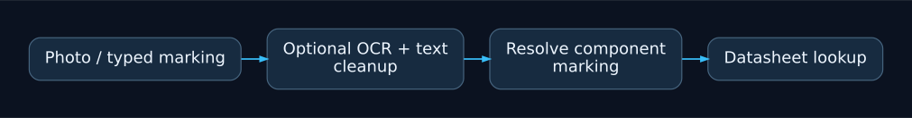
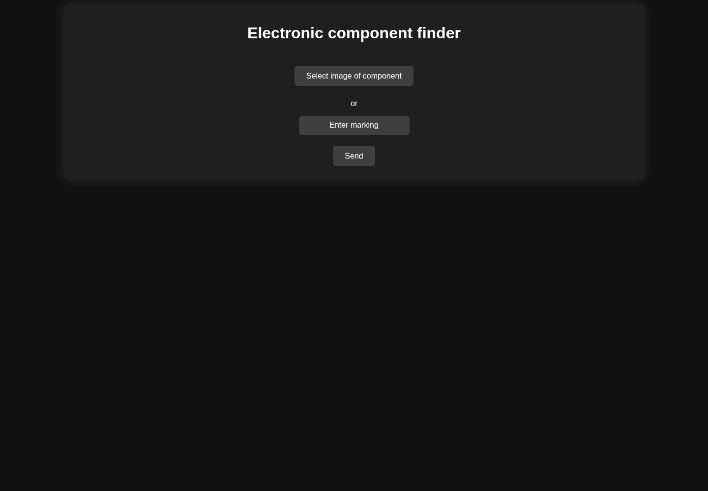

# Electronic Component Datasheet Finder

An experimental Flask application for extracting component markings from images
and looking up datasheets. The OCR pipeline and website scraping are research
prototypes, not a production recognition service.

## Project overview

An experimental Python and Flask application for component markings, OCR and datasheet lookup.



Research pipeline. The interface preview and mocked route tests do not measure OCR accuracy or website availability.

### Interface preview



The real Flask template rendered with empty result fields. This preview does not run OCR, load the model or contact a datasheet provider.


## Run locally

Python 3.11 is the reference environment for the archived scikit-learn model.
Use an isolated environment; model compatibility across scikit-learn versions
is not guaranteed. OCR dependencies and model downloads can be large.

```sh
python3.11 -m venv .venv
# Activate .venv using the command for your shell.
python -m pip install -r requirements.txt
cd electro_scanner
python server.py
```

Open http://127.0.0.1:5000. Run from `electro_scanner/`: the existing data/model
paths are relative to that directory. `difflib`, `csv`, `re` and concurrency
helpers come with Python and must not be installed from pip.

## Repository contents

* `electro_scanner/server.py`: Flask routes and result formatting.
* `electro_scanner/selen.py`: datasheet lookup (HTTP scraping, despite the name).
* `electro_scanner/compar.py`: matching markings against `elements.csv`.
* `electro_scanner/own_ocr/`: model training/inference research and saved model.
* `example_img/`: sample component photographs.
* `baza_obrazow_jpg.rar`: historical image dataset archive.

## Validation and limits

CI parses source files and exercises the Flask interface with OCR/network calls
stubbed out. It does not claim OCR accuracy, remote site availability, model
portability or dataset redistribution rights. To reproduce recognition results,
record the Python/scikit-learn versions, model checksum, input image and expected
marking. The saved pickle must only be loaded from a trusted source.

Original source code is MIT licensed; preserve any applicable original terms for
third-party code and datasets. Maintainer: Mateusz Sury.
